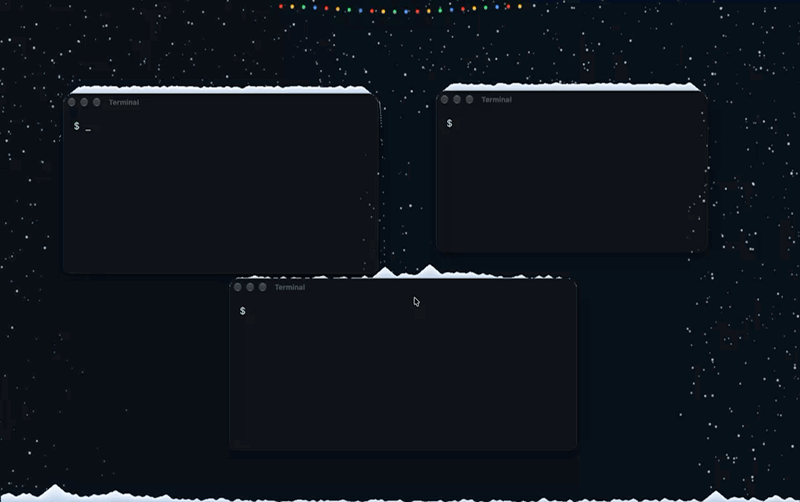

<h1> Flocon</h1>

Snow on your desktop and window tops! Christmas spirit directly beamed into your Mac!! Shake a window to knock it off, or push it aside with the cursor. Christmas lights included :)

[](assets/flocon-demo.mp4)

## Install

[Download Flocon.dmg](https://github.com/gbrach/flocon/releases/latest/download/Flocon.dmg), open it, and drag Flocon to Applications. Intel and Apple Silicon are supported, macOS 14 or later.

Flocon isn't signed with an Apple developer certificate (price is too steep for a little project like this...), so macOS will block it the first time:

1. Open Flocon. macOS says it can't be verified, click **Done**
2. Go to **System Settings → Privacy & Security**, scroll down and click **Open Anyway**
3. Open Flocon again and confirm. You only need to do this once

Prefer Terminal? `xattr -dr com.apple.quarantine /Applications/Flocon.app` does the same thing. Or build it yourself (below), no warning at all.

## Use

Click the snowflake in the menu bar to change snowfall, wind, accumulation, melting and lights; cozy winter, hot chocolate!

**Light Style** picks the bulb density (sparse to dense), the color (classic or warm white) and the blinking (steady, slow, fast, twinkle or chase)

**Behind Windows** keeps falling snow behind your apps while it still settles on window tops. The lights work with or without a notch! Get some Christmas spirit :)

Snow and lights pause when the lid is closed, or during sleep

## Updates

Flocon checks GitHub for a newer release at launch and tells you if there is one... You can also choose **Check for Updates...** in the menu. It's a request to GitHub's public releases page (with no account, identifiers or analytics).

## Build

If you want to build it yourself...
```sh
./build.sh
open build/Flocon.app
```
